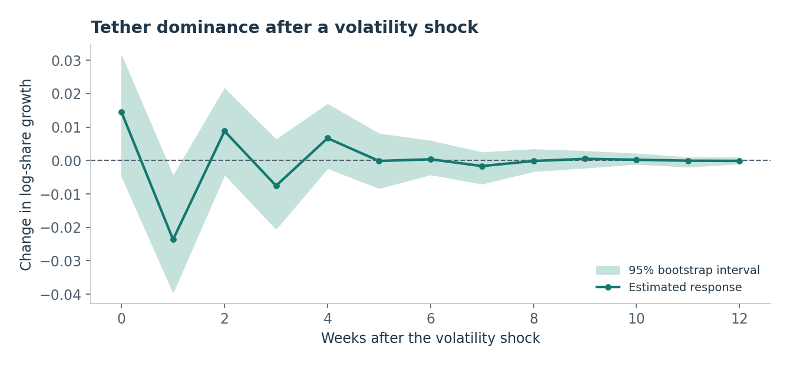

# TetherScope

When crypto volatility changes, does Tether's share of the market move next? I used weekly observations to examine the timing in both directions.

## Inside the R study

The notebook covers the full sequence from checking the workbook's seven-day spacing to interpreting an identified shock. I plot the two level series, compare five transformations with two stationarity tests, fit a univariate forecast, inspect residual dependence, and fit a two-variable model to test timing in both directions. The PDF shows the series, model tables and impulse response. Re-running the notebook rebuilds them from the public workbook. [R notebook](CryptoEconometrics.Rmd) · [Weekly observations](tether_market_dominance.xlsx) · [Rendered report](TetherScope.pdf)

## Method and result

I matched 115 consecutive weekly observations from October 2021 to December 2023 and fitted a three-lag vector autoregression. Past changes in log volatility helped predict changes in the growth rate of Tether's market share (Granger p = 0.0157). Testing the reverse direction gave p = 0.5001. These results describe predictive timing within this sample.


The [three-page English report](TetherScope.pdf) shows the weekly series, stationarity tests, forecast and impulse response. The [English R notebook](CryptoEconometrics.Rmd) runs directly on the [input workbook](tether_market_dominance.xlsx).

## Follow the model

| Step | Choice in the study | Reason |
| --- | --- | --- |
| Alignment | Sort weekly observations and check seven days between consecutive dates | A missing week changes what one lag means |
| Transformation | First difference of log volatility, second difference of log market share | Study changes in volatility and changes in the growth rate of dominance |
| Forecast | MA(1) on the transformed dominance series, three weeks ahead | Keep the forecast and its interval in the fitted units |
| Directional test | VAR with an intercept and three lags, tested in both directions | Compare whether one series adds predictive information beyond the other's own past |

### What one weekly observation means

Let $V_t$ be the volatility index and $D_t$ Tether's share in week $t$. I multiply the workbook's share by 100 for the level chart. Using a constant percentage scale cancels out of the log differences. The two variables entering the model are the change in log volatility $x_t$ and the change in the growth rate of dominance $y_t$.

```math
x_t=\log(V_t/V_{t-1}),\qquad y_t=\log(D_t/D_{t-1})-\log(D_{t-1}/D_{t-2})
```

The first three market shares are **2.5901%, 2.5930% and 2.5223%**. Substituting the unrounded shares gives $y_t=-0.02874$ for the week ending 7 November 2021. Dominance edged up in the second week and then fell in the third. Two differences leave **113 paired observations** from the original 115 weeks.

### What the directional test asks

With three lags, **110 weeks** enter each fitted equation. In the dominance equation I let past volatility changes compete with dominance's own history.

```math
y_t=a+\sum_{\ell=1}^{3}\beta_\ell x_{t-\ell}+\sum_{\ell=1}^{3}\gamma_\ell y_{t-\ell}+\varepsilon_t
```

The joint test of $\beta_1=\beta_2=\beta_3=0$ gives **F = 3.535, p = 0.0157**. Testing the three lagged dominance terms in the volatility equation gives **F = 0.791, p = 0.5001**. At 5% the extra lags improve the fit in the first direction. These are within-sample tests on transformed series. They give no estimate of a causal effect on Tether's market share.

The report also fits a separate MA(1) forecast to $y_t$. Its first weekly forecast is **0.00476**, with a 95% interval from **−0.10295 to 0.11247** in the same log-difference units. The 12-week impulse response uses 499 bootstrap runs and orders volatility first. [Transformations, fitted models and diagnostics](CryptoEconometrics.Rmd)

The [input function](R/data.R) checks the weekly spacing, positivity and finiteness of both input series. In R, run `source("R/data.R", encoding = "UTF-8")` and `head(read_weekly_market())` to inspect the aligned rows before fitting a model.

## Why I difference the two series differently

The ADF regression includes a drift and one lag of the differenced series. It tests the coefficient $\gamma$ on the lagged level. The KPSS test asks whether a series is level-stationary and compares the cumulative demeaned residuals $S_t$ with a long-run variance estimate $\widehat\omega^2$.

```math
\Delta z_t=a+\gamma z_{t-1}+\phi\Delta z_{t-1}+u_t,\qquad
\mathrm{KPSS}=\frac{\sum_{t=1}^{n}S_t^2}{n^2\widehat\omega^2}.
```

| Transformation | ADF statistic | KPSS statistic |
| --- | ---: | ---: |
| Log volatility level | −2.190 | 1.710 |
| First difference of log volatility | −8.462 | 0.095 |
| Log dominance level | −2.737 | 1.496 |
| First difference of log dominance | −7.468 | 0.548 |
| Second difference of log dominance | −12.739 | 0.023 |

At the reported 5% cutoffs, ADF rejects a unit root below −2.88 and KPSS rejects level stationarity above 0.463. For dominance the first difference still exceeds the KPSS cutoff. The second difference clears both checks in this sample. For the VAR, AIC, HQ and FPE select three lags, while the Schwarz criterion selects one.

## Forecast errors and the response to a shock

For the separate dominance forecast I fit an MA(1) to $y_t$, the second difference of log share. Under the fitted model, only the first forecast step carries the last estimated innovation.

```math
y_t=\mu+\varepsilon_t+\theta\varepsilon_{t-1},\qquad
\hat y_{t+1|t}=\mu+\theta\hat\varepsilon_t,\qquad
\hat y_{t+h|t}=\mu\quad(h\ge2).
```

The fitted coefficient is about **−1.000** and the mean is **−0.000404**. Weeks two and three therefore have the same point forecast. The coefficient falls close to the invertibility boundary, which is worth keeping in mind when reading the three-week extrapolation. To check remaining autocorrelation I use the Ljung-Box statistic with 20 lags and one fitted MA coefficient.

```math
Q=n(n+2)\sum_{k=1}^{20}\frac{\hat\rho_k^2}{n-k}.
```

Here **Q = 21.079** on **19 degrees of freedom**, giving **p = 0.3324**. The test leaves little evidence of remaining serial correlation at those lags.

The bivariate VAR answers a different question. I write its lag matrices as $A_1,A_2,A_3$ and factor the residual covariance as $PP^\top=\Sigma_\varepsilon$, ordering volatility first. The response to a one-standard-deviation volatility innovation at horizon $h$ is the dominance component of the first column of $\Psi_hP$.

```math
\Psi_0=I,\qquad \Psi_h=\sum_{j=1}^{\min(3,h)}A_j\Psi_{h-j},\qquad
\mathrm{IRF}_{y\leftarrow x}(h)=e_y^\top\Psi_hP e_x.
```



With 499 bootstrap draws and seed 2024, the response at week one is **−0.02365**, with a 95% interval of **−0.03931 to −0.00476**. At week two it is **+0.00879**, with an interval spanning zero. By week twelve the estimate is **−0.00012**. The vertical axis is a change in log-share growth. Reading it as a percentage-point change in Tether's market share would give a different quantity. [Forecast, identification and bootstrap code](CryptoEconometrics.Rmd)

## Reproduce the report

From the repository directory, use R with Pandoc and XeLaTeX installed.

```r
install.packages(c("rmarkdown", "readxl", "urca", "vars", "forecast"))
rmarkdown::render("CryptoEconometrics.Rmd", output_file = "TetherScope.pdf")
```

Tom Bussard
