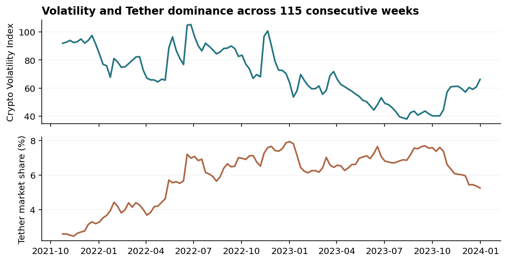

# TetherScope

When crypto volatility changes, does Tether's share of the market move next? I used weekly observations to examine the timing in both directions.

## Method and result

I matched 115 consecutive weekly observations from October 2021 to December 2023 and fitted a three-lag vector autoregression. Past changes in log volatility helped predict changes in the growth rate of Tether's market share (Granger p = 0.0157). Testing the reverse direction gave p = 0.5001. These results describe predictive timing within this sample.



The [three-page English report](TetherScope.pdf) shows the weekly series, stationarity tests, forecast and impulse response. The [English R notebook](CryptoEconometrics.Rmd) runs directly on the [input workbook](tether_market_dominance.xlsx).

## Follow the model

| Step | Choice in the study | Reason |
| --- | --- | --- |
| Alignment | Sort weekly observations and check seven days between consecutive dates | A missing week changes what one lag means |
| Transformation | First difference of log volatility, second difference of log market share | Study changes in volatility and changes in the growth rate of dominance |
| Forecast | MA(1) on the transformed dominance series, three weeks ahead | Keep the forecast and its interval in the fitted units |
| Directional test | VAR with an intercept and three lags, tested in both directions | Compare whether one series adds predictive information beyond the other's own past |

### What one weekly observation means

Let $V_t$ be the volatility index and $D_t$ Tether's share in week $t$. I multiply the workbook's share by 100 for the level chart. Using a constant percentage scale cancels out of the log differences. The two variables entering the model are the change in log volatility $x_t$ and the change in the growth rate of dominance $y_t$.

```math
x_t=\log(V_t/V_{t-1}),\qquad y_t=\log(D_t/D_{t-1})-\log(D_{t-1}/D_{t-2})
```

The first three market shares are **2.5901%, 2.5930% and 2.5223%**. Substituting the unrounded shares gives $y_t=-0.02874$ for the week ending 7 November 2021. Dominance edged up in the second week and then fell in the third. Two differences leave **113 paired observations** from the original 115 weeks.

### What the directional test asks

With three lags, **110 weeks** enter each fitted equation. In the dominance equation I let past volatility changes compete with dominance's own history.

```math
y_t=a+\sum_{\ell=1}^{3}\beta_\ell x_{t-\ell}+\sum_{\ell=1}^{3}\gamma_\ell y_{t-\ell}+\varepsilon_t
```

The joint test of $\beta_1=\beta_2=\beta_3=0$ gives **F = 3.535, p = 0.0157**. Testing the three lagged dominance terms in the volatility equation gives **F = 0.791, p = 0.5001**. At 5% the extra lags improve the fit in the first direction. These are within-sample tests on transformed series. They give no estimate of a causal effect on Tether's market share.

The report also fits a separate MA(1) forecast to $y_t$. Its first weekly forecast is **0.00476**, with a 95% interval from **−0.10295 to 0.11247** in the same log-difference units. The 12-week impulse response uses 499 bootstrap runs and orders volatility first. [Transformations, fitted models and diagnostics](CryptoEconometrics.Rmd)

The [input function](R/data.R) checks the weekly spacing, positivity and finiteness of both input series. In R, run `source("R/data.R", encoding = "UTF-8")` and `head(read_weekly_market())` to inspect the aligned rows before fitting a model.

## Reproduce the report

From the repository directory, use R with Pandoc and XeLaTeX installed.

```r
install.packages(c("rmarkdown", "readxl", "urca", "vars", "forecast"))
rmarkdown::render("CryptoEconometrics.Rmd", output_file = "TetherScope.pdf")
```

Tom Bussard
